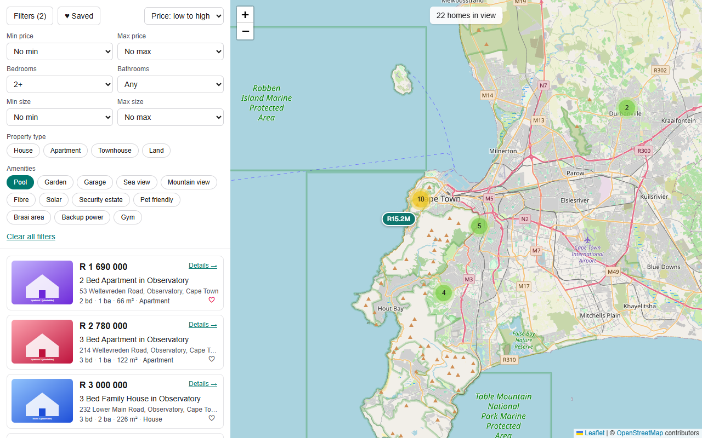
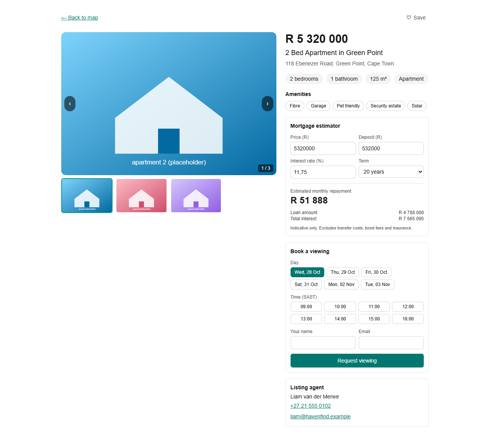
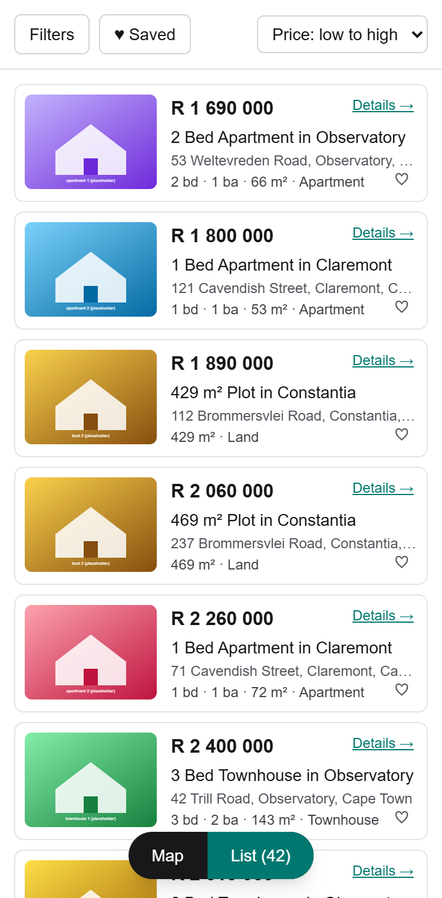
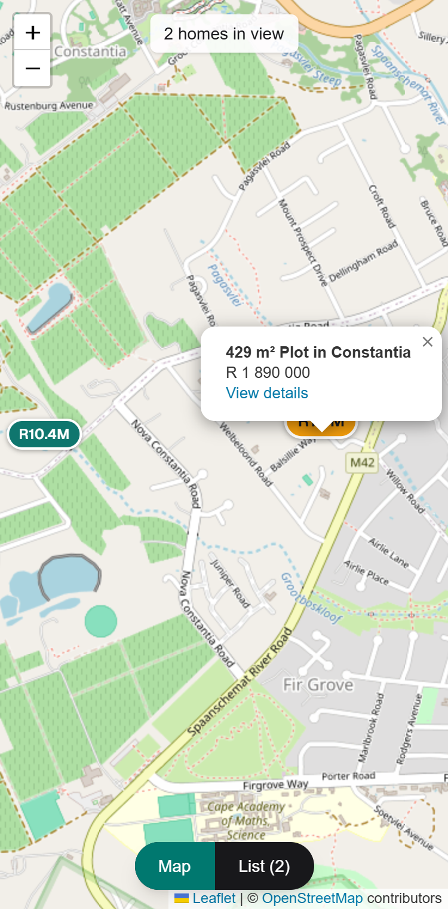

# HavenFind

Map-first real estate discovery: pan a live map, filter 48 Cape Town listings in real time, estimate the mortgage, save homes and book a viewing.

**Live demo:** https://havenfind-476.netlify.app



## What it does

- **Map and list, kept in sync.** The listings API runs a PostGIS bounding-box query for the current viewport. Pins cluster, and hovering a card highlights its pin (and the reverse). Choosing a card zooms out of any cluster and opens its popup.
- **Filters in the URL.** Price range, bedrooms, bathrooms, size, property type, amenities and sort. State lives in the query string, so a search can be shared or reloaded.
- **Listing detail.** Photo gallery (keyboard and thumbnail navigation), agent contact, and a mortgage estimator (price, deposit, rate and term).
- **Saved homes.** Heart any listing; saved homes persist in the browser and are listed on `/saved`.
- **Viewing bookings.** Pick a day and time slot and leave your details. Double-booking is prevented by the database.
- **Responsive and accessible.** On phones the map and list switch with a floating toggle. An automated axe-core audit reports 0 violations on all pages in light and dark mode.

| Listing detail | List (mobile) | Map (mobile) |
| --- | --- | --- |
|  |  |  |

## What to demo to a recruiter

1. **Spatial search end to end.** Pan and zoom the map: the list and count update from a PostGIS bounding-box query (GIST-indexed). Hover a card to light up its pin, click it to jump to the listing on the map.
2. **Shareable filter state.** Apply 2+ bedrooms and Pool, then copy the URL into a new tab: the same results load. Switch to a 375px window to see the map/list toggle.
3. **Correctness details.** Open a listing, adjust the mortgage estimator, and book a viewing. Try booking the same slot again: the unique index makes the second request fail cleanly (HTTP 409), even under concurrent requests.

## Stack

| Area | Choice |
| --- | --- |
| Framework | Next.js 16 (App Router), React 19, TypeScript (`strict`) |
| Styling | Tailwind CSS 4, light and dark themes that follow the system setting |
| Maps | Leaflet, react-leaflet, leaflet.markercluster, OpenStreetMap tiles (no API key) |
| Database | Neon Postgres with PostGIS, Drizzle ORM (`@neondatabase/serverless`, HTTP driver) |
| Validation | zod |
| Tests | Vitest, React Testing Library |
| Hosting | Netlify |

## Architecture notes

- **Spatial query.** `listings.location` is a `geometry(Point, 4326)` column with a GIST index. The API filters with `location && ST_MakeEnvelope(...)` and derives `lat`/`lng` with `ST_Y`/`ST_X`. Filters (`price`, beds, amenities via `@>` array containment, and so on) are composed in one query, and results are capped at 500 with a separate total count.
- **Client-only map.** Leaflet touches `window`, so the map is loaded with `next/dynamic` and `ssr: false` from a Client Component. The marker-cluster plugin needs a global `L`, so it is loaded inside an effect.
- **No stale popups.** Panning refetches listings, but the hook keeps the same array when the visible homes are unchanged, so markers and open popups are not rebuilt.
- **URL as the source of truth for filters.** A pure parse/serialise pair in `lib/filters.ts` (zod-validated) feeds both the panel and the fetch. Invalid URLs fall back to defaults.
- **Saved homes without hydration bugs.** Stored in `localStorage` and read through `useSyncExternalStore` with an empty server snapshot, so server and client markup always match. Stored data is validated with zod; corrupt or tampered data is ignored.
- **Bookings.** One module (`lib/booking-slots.ts`) generates the offered slots (hourly, 09:00 to 16:00 SAST, Monday to Saturday, next 7 days). The form and the API both use it, so the server only accepts times the form can offer. A unique index on `(listing_id, slot)` is the final guard against races.
- **Quality.** 27 unit and component tests (mortgage maths, slot generation, saved-homes logic, the calculator UI), `tsc --noEmit` and ESLint clean with no rules disabled, files kept under 300 lines.

## Run locally

Requires Node 20+ and a free [Neon](https://neon.tech) project.

```bash
npm install
cp .env.example .env.local        # then set DATABASE_URL to your Neon connection string
npm run db:migrate                # enables PostGIS and creates the tables
npm run db:seed                   # 4 agents and 48 Cape Town listings
npm run dev                       # http://localhost:3000
```

Other scripts: `npm test`, `npm run lint`, `npm run typecheck`, `npm run build`.

`npm run db:seed` clears and reloads the agents, listings and bookings tables, so only run it on a demo database.

## Limitations

- Listings, agents and prices are fictional seed data. Photos are generated placeholder illustrations (see `TODO-ASSETS.md`).
- No accounts: saved homes live in the browser only.
- Viewing requests are stored but no confirmation email is sent, and there is no rate limiting.
- The mortgage estimate is indicative: it ignores transfer costs, bond fees and insurance.

## Phase 2

- Agent viewing booking calendar
- Draw-a-boundary polygon search
- Compare listings
- Email alert signups (stored only)
